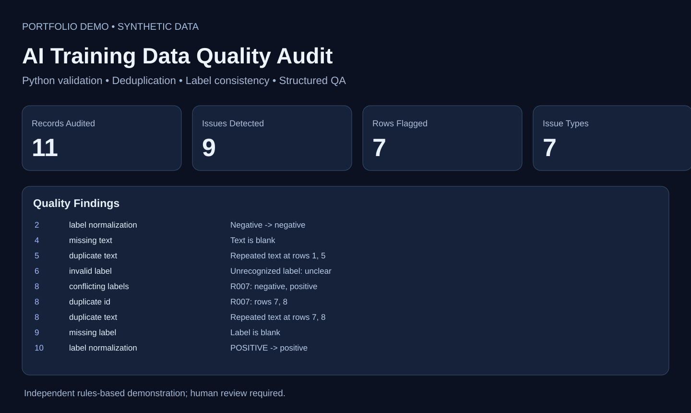

# AI Training Dataset Quality Audit — Python QA & Reporting

Independent portfolio demonstration built with the Python standard library and **synthetic** customer-feedback training rows. This is not a model-training pipeline, a production integration, or a paid-client deployment.

## What it demonstrates

- Label vocabulary validation and case-normalization suggestions
- Duplicate record IDs and conflicting labels
- Duplicate text after whitespace and case normalization
- Missing identifiers, text, and labels
- Structured JSON quality findings, issue counts, and self-contained HTML dashboard
- Non-destructive audits requiring human review before data corrections

## Run

Run \`python app.py\` to generate \`quality_report.json\` and \`quality_report.html\` from \`sample_training_data.csv\`.

Run \`python -m unittest -v test_app\`.

Unit tests cover data-quality edge cases and HTML escaping. Python 3.9+; no third-party packages.

## Honesty and limitations

This is a deterministic rules-based prototype using fictional records. It does not demonstrate human label adjudication, semantic mislabel detection, model-training accuracy, external customer integration, or security compliance. Before processing private or regulated data, implement agreed access controls and retention rules.

## Upwork portfolio copy

**Project title:** AI Training Data Quality Audit | Python Validation Dashboard

**Your role:** Python Data Quality & Automation Developer

**Description:** Built a reproducible Python data-quality prototype for AI training datasets. It identifies missing data, duplicate records, conflicting labels, inconsistent category names, and repeated text, then generates structured JSON findings and a standalone HTML QA dashboard. Includes synthetic training records, unit tests, and clear human-review limitations. Independent technical demonstration, not client deployment.

**Suggested skills:** Python; Data Cleaning; Data Quality; Data Validation; Data Analysis
