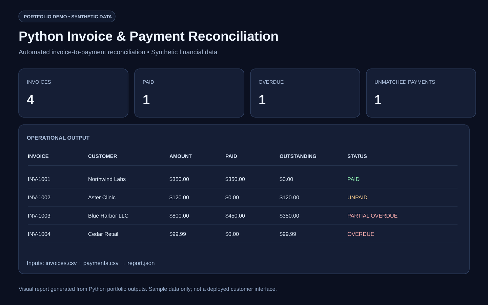
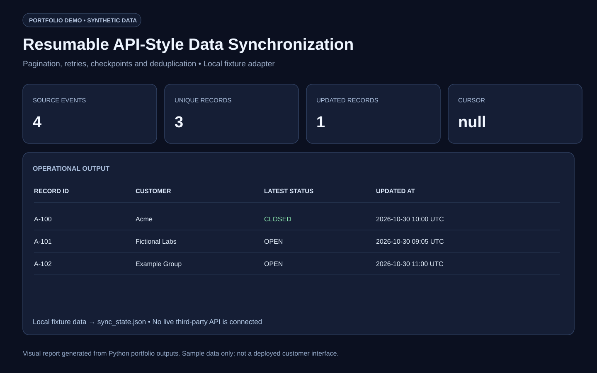
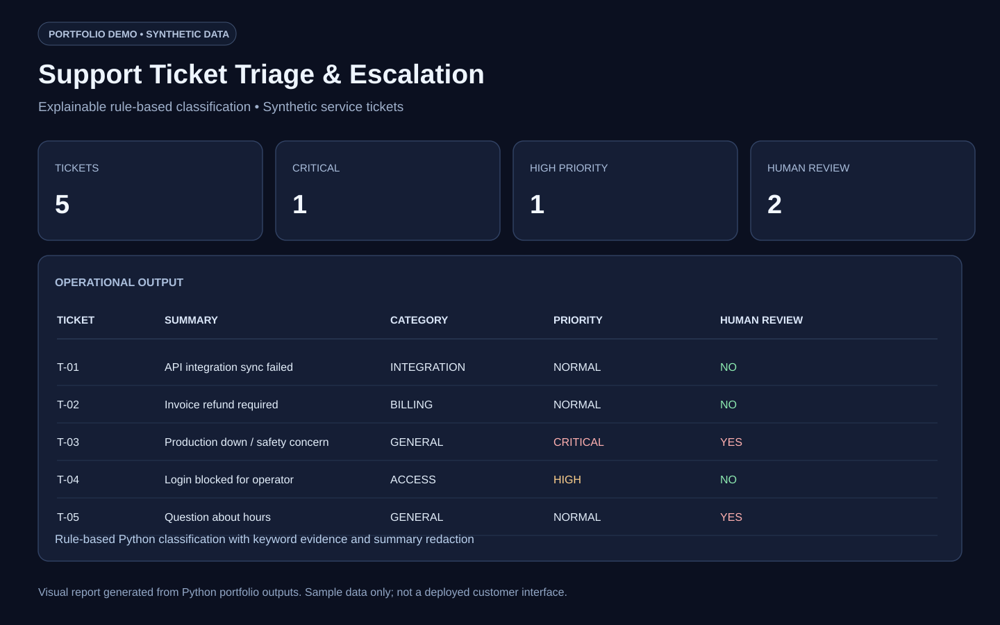
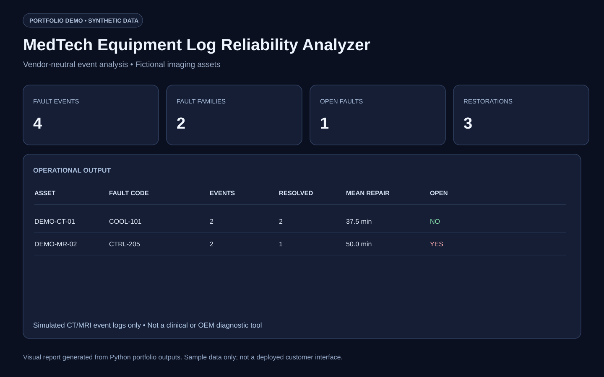
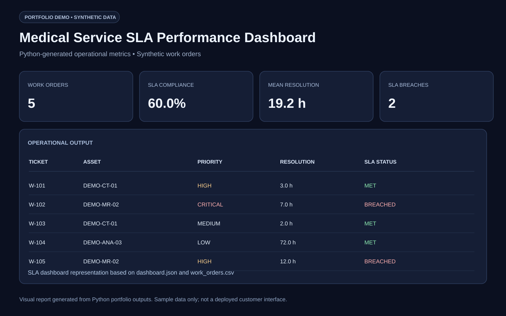
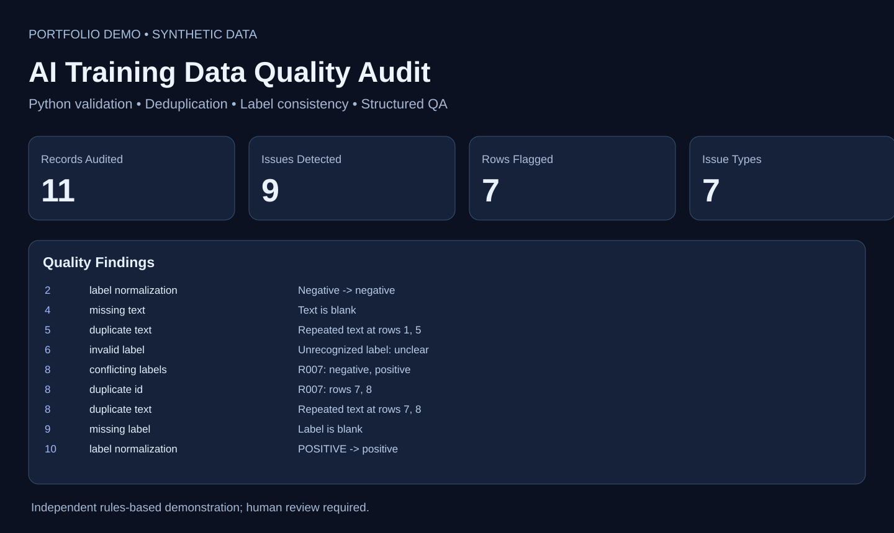

# Python Automation & MedTech Reliability — Six Project Portfolio

Six independently runnable **Python standard-library** demos using **fictional data**. Every folder contains `app.py`, a synthetic sample dataset and automated tests (`test_app.py`). No paid customer outcomes or clinical qualifications are represented.

| Project | Business problem solved |
|---|---|
| 01 Invoice Reconciliation | Match invoices/payments and identify exceptions |
| 02 API-style Data Sync | Pagination, retries, checkpoints and deduplication |
| 03 Support Ticket Triage | Route cases and flag high-risk tickets for human review |
| 04 MedTech Log Monitor | Identify repeated equipment faults and calculate restoration times |
| 05 SLA Dashboard | Track breaches, average resolution and repeat-incident assets |
| [06 AI Data Quality Audit](06_ai_training_data_quality/) | Detect duplicate data, conflicting labels and QA errors in synthetic AI training records |

Run the application with `python app.py` from its folder; run `python -m unittest -v test_app` in that folder. No extra Python dependencies.

The first five demos passed 25 local unit tests; the new AI Data Quality Audit passed 11 additional local unit tests (36 in total). For full project summaries, consult [UPWORK_PORTFOLIO_COPY.md](UPWORK_PORTFOLIO_COPY.md).

**Important:** This repository contains simulated scenarios and synthetic records. It is not a deployed healthcare diagnostic product, a regulated medical device, or evidence of a past paid software contract.

## Visual portfolio previews

These are **demonstration-only visualizations** of the synthetic reports, not screenshots of deployed customer products. Select a preview to open the SVG image stored with the corresponding code:

| Project | Visual preview |
|---|---|
| Invoice reconciliation |  |
| API-style data sync |  |
| Support ticket triage |  |
| MedTech log monitor |  |
| Service SLA dashboard |  |
| AI training data quality audit |  |

[Open the dedicated visual preview index](VISUAL_PREVIEWS.md).
